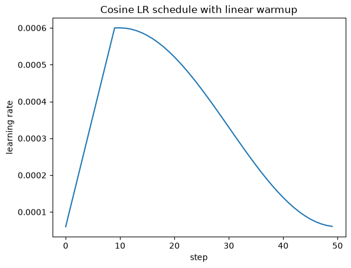

# Cosine Learning Rate Scheduler with Linear Warmup

## 1. Setup

Same as eval_03 (random init `GPT(GPTConfig())`, B = 16, T = 1024, AdamW betas (0.9, 0.95), eps 1e-8, gradient clipping 1.0, bf16, `torch.compile`, 50 steps) plus a learning rate schedule. The 2D-only weight decay and gradient accumulation are still off. Note that `torch.optim.AdamW(model.parameters(), ...)` applies its default `weight_decay=0.01` to every parameter in this run.

| Hyperparameter | Value |
|---|---|
| `max_lr` | 6e-4 (GPT-3 Small) |
| `min_lr` | `max_lr * 0.1` = 6e-5 |
| `warmup_steps` | 10 |
| `max_steps` | 50 |

## 2. Change

`get_lr(it)` computes the learning rate for each step, and the value is written into every `param_group` before `optimizer.step()`:

- **Linear warmup (steps 0–9):** `lr = max_lr * (it + 1) / warmup_steps` gives 6e-5, 1.2e-4, …, 6e-4. At the start the weights are random and the gradients are large and noisy, so small steps keep the model from being thrown off.
- **Cosine decay (steps 10–50):** `decay_ratio = (it - warmup_steps) / (max_steps - warmup_steps)`, `coeff = 0.5 * (1 + cos(pi * decay_ratio))`, `lr = min_lr + coeff * (max_lr - min_lr)`. The LR goes smoothly from 6e-4 down to 6e-5. Smaller steps near the end let the model settle into a minimum instead of bouncing around it.
- **After `max_steps`:** `lr = min_lr`.

## 3. Learning Rate Curve



The curve is drawn from the `lrs` list collected during training (`plt.plot(lrs)` → `lrs_graph.png`, copied here as `lrs/graph_1.png`).

## 4. Training Log (every step)

| Step | Loss | LR | Grad Norm | dt (ms) | tok/sec |
|---:|---:|---:|---:|---:|---:|
| 0 | 10.9473 | 6.0000e-05 | 28.5689 | 2,382.33 | 6,877 |
| 1 | 9.5024 | 1.2000e-04 | 10.6567 | 121.50 | 134,843 |
| 2 | 9.2515 | 1.8000e-04 | 7.3739 | 133.72 | 122,523 |
| 3 | 9.7625 | 2.4000e-04 | 6.6550 | 127.04 | 128,963 |
| 4 | 9.1051 | 3.0000e-04 | 4.2451 | 129.11 | 126,901 |
| 5 | 8.7950 | 3.6000e-04 | 3.2617 | 128.18 | 127,825 |
| 6 | 8.5859 | 4.2000e-04 | 2.3583 | 128.26 | 127,745 |
| 7 | 8.2656 | 4.8000e-04 | 2.0502 | 129.07 | 126,934 |
| 8 | 7.8885 | 5.4000e-04 | 2.2146 | 128.12 | 127,878 |
| 9 | 7.5198 | 6.0000e-04 | 2.1455 | 126.25 | 129,775 |
| 10 | 7.1467 | 6.0000e-04 | 1.8081 | 127.19 | 128,820 |
| 11 | 6.8933 | 5.9917e-04 | 1.2593 | 129.95 | 126,080 |
| 12 | 6.6125 | 5.9668e-04 | 1.0882 | 128.34 | 127,658 |
| 13 | 6.6526 | 5.9254e-04 | 1.1940 | 127.36 | 128,643 |
| 14 | 6.6729 | 5.8679e-04 | 1.1497 | 131.28 | 124,803 |
| 15 | 6.5142 | 5.7945e-04 | 1.4131 | 126.03 | 130,006 |
| 16 | 6.5296 | 5.7057e-04 | 1.1997 | 128.39 | 127,615 |
| 17 | 6.5223 | 5.6021e-04 | 0.8653 | 129.72 | 126,299 |
| 18 | 6.5539 | 5.4843e-04 | 1.2059 | 129.51 | 126,510 |
| 19 | 6.3749 | 5.3531e-04 | 1.6447 | 129.30 | 126,712 |
| 20 | 6.5039 | 5.2092e-04 | 1.7116 | 130.28 | 125,759 |
| 21 | 6.2016 | 5.0535e-04 | 1.2416 | 128.37 | 127,632 |
| 22 | 6.2732 | 4.8870e-04 | 1.0735 | 133.25 | 122,960 |
| 23 | 6.1778 | 4.7107e-04 | 1.2906 | 130.98 | 125,084 |
| 24 | 6.0836 | 4.5258e-04 | 1.0937 | 131.08 | 124,994 |
| 25 | 6.3170 | 4.3332e-04 | 1.0759 | 129.62 | 126,400 |
| 26 | 6.4015 | 4.1343e-04 | 1.2605 | 128.24 | 127,761 |
| 27 | 6.2693 | 3.9303e-04 | 1.2222 | 130.51 | 125,538 |
| 28 | 6.1702 | 3.7224e-04 | 0.7300 | 129.36 | 126,656 |
| 29 | 6.0782 | 3.5118e-04 | 0.9100 | 130.59 | 125,459 |
| 30 | 6.0536 | 3.3000e-04 | 0.9242 | 130.53 | 125,514 |
| 31 | 6.0352 | 3.0882e-04 | 0.8436 | 127.39 | 128,614 |
| 32 | 5.9653 | 2.8776e-04 | 0.8519 | 130.66 | 125,395 |
| 33 | 6.1109 | 2.6697e-04 | 0.9106 | 129.18 | 126,831 |
| 34 | 6.2325 | 2.4657e-04 | 0.8230 | 130.59 | 125,464 |
| 35 | 6.0928 | 2.2668e-04 | 0.8203 | 130.54 | 125,507 |
| 36 | 6.0562 | 2.0742e-04 | 0.9237 | 128.50 | 127,499 |
| 37 | 6.0460 | 1.8893e-04 | 0.7497 | 130.74 | 125,315 |
| 38 | 6.0666 | 1.7130e-04 | 1.0473 | 129.29 | 126,722 |
| 39 | 5.9324 | 1.5465e-04 | 1.1853 | 131.32 | 124,765 |
| 40 | 6.1286 | 1.3908e-04 | 0.7572 | 130.54 | 125,505 |
| 41 | 5.8767 | 1.2469e-04 | 1.0330 | 129.91 | 126,121 |
| 42 | 5.9998 | 1.1157e-04 | 0.8395 | 132.38 | 123,760 |
| 43 | 5.8617 | 9.9787e-05 | 0.8045 | 128.77 | 127,230 |
| 44 | 5.8057 | 8.9428e-05 | 0.8098 | 131.17 | 124,911 |
| 45 | 6.0140 | 8.0553e-05 | 0.8507 | 129.73 | 126,297 |
| 46 | 6.1486 | 7.3215e-05 | 0.7574 | 131.99 | 124,133 |
| 47 | 6.0310 | 6.7460e-05 | 0.7428 | 130.81 | 125,251 |
| 48 | 5.9678 | 6.3324e-05 | 0.5737 | 132.01 | 124,112 |
| 49 | 5.8820 | 6.0832e-05 | 0.7351 | 131.78 | 124,331 |

## 5. Summary

| Metric | Constant LR 3e-4 (eval_03) | Cosine + warmup (this run) |
|---|---:|---:|
| Initial LR | 3.0000e-04 | 6.0000e-05 |
| Peak LR | 3.0000e-04 | 6.0000e-04 (steps 9–10) |
| Final LR (step 49) | 3.0000e-04 | 6.0832e-05 |
| Initial loss | 10.9473 | 10.9473 |
| Loss at step 10 | 7.3087 | 7.1467 |
| Final loss (step 49) | 5.9020 | 5.8820 |
| Lowest loss | 5.8466 (step 44) | 5.8057 (step 44) |
| Mean gradient norm (last 10 steps) | 1.02 | 0.79 |
| Steps clipped (norm > 1.0) | 38 / 50 | 30 / 50 |
| Average step time (steps 1–49) | 129.24 ms | 129.56 ms |

## 6. Observations

- During warmup the loss is higher than with a constant LR for the first steps (step 3: 9.76 vs 8.76), because the LR starts 5× smaller (6e-5). Once the LR reaches its peak of 6e-4, twice the constant value, the model catches up and passes it: 7.15 vs 7.31 at step 10 and 6.61 vs 6.94 at step 12.
- In the decay phase the gradient norm gets smaller and calmer (mean 0.79 over the last 10 steps vs 1.02 with the constant LR), and fewer steps need clipping: 30 vs 38 in total, and only 3 of the last 20 steps vs 10.
- The final and lowest losses are slightly better than with the constant LR (5.88 vs 5.90 and 5.81 vs 5.85).
- Step time does not change. The schedule only costs a few Python operations per step.

## 7. Implementation

```python
max_lr = 6e-4
min_lr = max_lr * 0.1
warmup_steps = 10
max_steps = 50
def get_lr(it):
    if it < warmup_steps:
        return (max_lr * (it+1) / warmup_steps)

    if it > max_steps:
        return min_lr

    decay_ratio = (it - warmup_steps) / (max_steps - warmup_steps)
    assert 0 <= decay_ratio <= 1

    coeff = 0.5 * (1.0 + math.cos(math.pi * decay_ratio))
    return (min_lr + coeff * (max_lr - min_lr))

# inside the training loop
lr = get_lr(i)
for param_group in optimizer.param_groups:
    param_group['lr'] = lr
lrs.append(lr)
optimizer.step()

# after training
plt.plot(lrs)
plt.xlabel('step')
plt.ylabel('learning rate')
plt.title('Cosine LR schedule with linear warmup')
plt.savefig('lrs_graph.png', bbox_inches='tight')
```
