# Final Evaluation: GPT-2 124M on Turkish and English

The same GPT-2 124M model (`train_gpt2.py`) was trained from scratch twice: once on Turkish, once on English. Every 100 steps it logs the validation loss, a HellaSwag score and 4 text samples.

## Summary

| | Turkish model | English model |
|---|---|---|
| Data | [`tascib/turkish-llm-dataset`](https://huggingface.co/datasets/tascib/turkish-llm-dataset) | FineWeb-Edu (`sample-10BT`) |
| Steps | 707 (stopped by hand) | 810 |
| Tokens seen | ≈ 371M | ≈ 425M |
| Last val loss | **2.1427** (step 700) | **4.4806** (step 800) |
| GPT-2 124M val loss on same data | 4.1691 | 3.2924 |
| Last HellaSwag | **0.2590** (hellaswag-tr) | **0.2496** (HellaSwag) |
| HellaSwag references | GPT-2 0.2750, turkish-gpt2 0.3112 | GPT-2 0.2945, GPT-3 0.337 |

- **Turkish:** val loss beat GPT-2 before step 200. HellaSwag-TR is slowly rising above chance (0.25).
- **English:** val loss is still 1.19 above GPT-2. HellaSwag is still at chance.
- Both runs are early: about 4% of the planned 19,073 steps.

## 1. Setup

| Setting | Value |
|---|---|
| Model | GPT-2 124M, 12 layers, 768 dim, vocab 50,304, 124,475,904 parameters |
| Tokenizer | GPT-2 (`tiktoken`) for both languages |
| Batch | B=64, T=1024, 524,288 tokens/step (8 accumulation steps) |
| Optimizer | AdamW (fused), weight decay 0.1, grad clip 1.0 |
| LR | warmup to 6e-4 in 715 steps, cosine decay to 6e-5 |
| Precision | bf16 autocast, TF32, no `torch.compile` |
| GPU | 1 × NVIDIA H100 NVL (94 GB) |

**Every 100 steps:**

- **Val loss:** 20 batches (1.31M tokens) from the val shard.
- **HellaSwag:** acc_norm, full val set. Turkish: [`malhajar/hellaswag-tr`](https://huggingface.co/datasets/malhajar/hellaswag-tr) (10,041). English: original HellaSwag (10,042).
- **Samples:** 4 × 32 tokens, top-k 50.
- **Log:** `log/log.txt`, plotted in `play.ipynb`.

**References:**

| Reference | Turkish | English |
|---|---|---|
| GPT-2 124M val loss | 4.1691 (our TR val shard) | 3.2924 (FineWeb-Edu) |
| GPT-2 124M HellaSwag | 0.2750 | 0.2945 |
| Stronger model | turkish-gpt2: 0.3112 | GPT-3 124M: 0.337 |
| Random | 0.25 | 0.25 |

GPT-2 knows almost no Turkish, so it is near random on hellaswag-tr. [`ytu-ce-cosmos/turkish-gpt2`](https://huggingface.co/ytu-ce-cosmos/turkish-gpt2) has the same architecture, trained on Turkish.

## 2. Turkish model

| Run | Steps | Speed | Result |
|---|---|---|---|
| 1 | 0–100 | 4.62 s/step | crashed at step 100 |
| 2 | 0–214 | 4.62 s/step | fix works |
| 3 | 0–707 | 1.79 s/step | main run |

### Run 1: crash at step 100

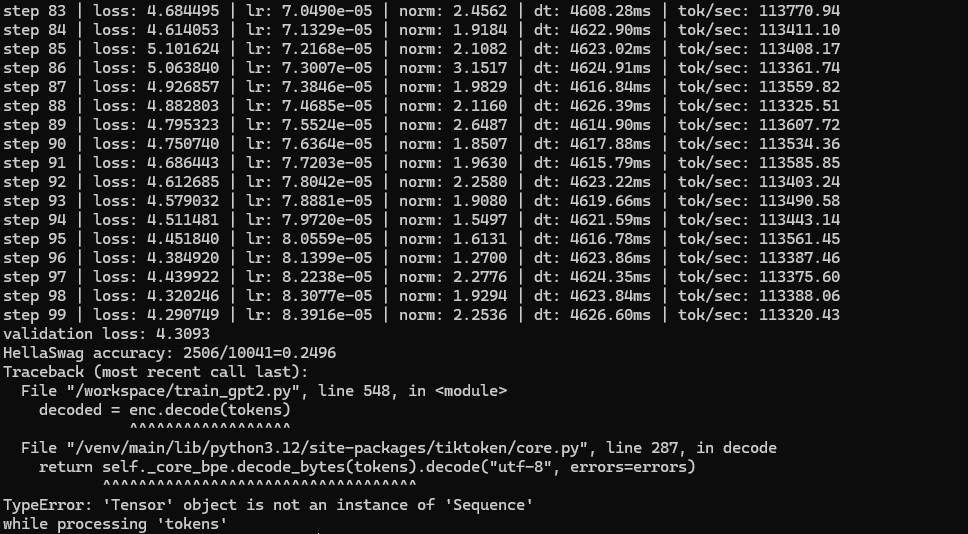

*Val 4.3093 · HellaSwag-TR 0.2496 · then a crash in sample generation.*

`tiktoken` needs a list, not a tensor. Fix:

```python
tokens = xgen[_, :max_length].tolist()
```

### Run 2

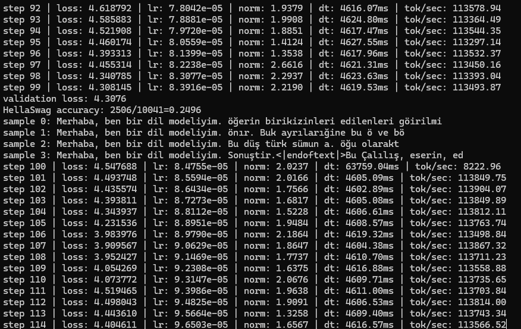

*Step 100 · val 4.3076 · HellaSwag-TR 0.2496 · samples are word pieces: `öğerin birikizinleri edilenleri`*

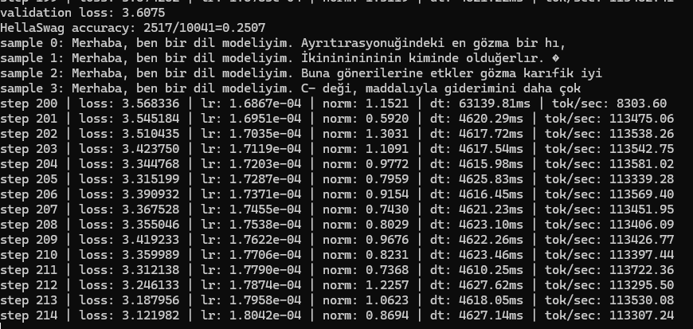

*Step 200 · val 3.6075 (below GPT-2's 4.1691) · HellaSwag-TR 0.2507*

### Run 3

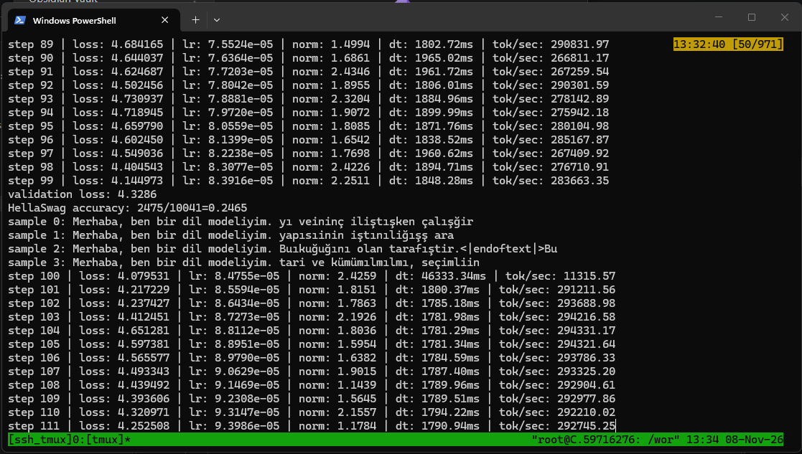

*Step 100 · val 4.3286 · HellaSwag-TR 0.2465 · 2.6× faster than run 2 · samples are still noise*

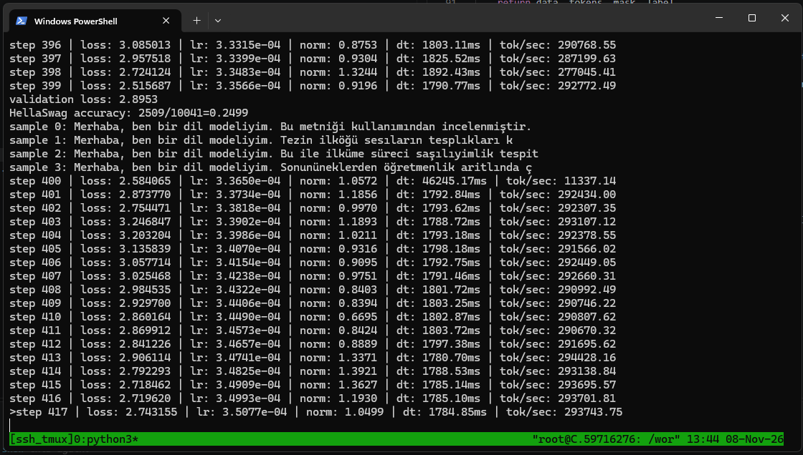

*Step 400 · val 2.8953 · HellaSwag-TR 0.2499 · first real word endings: `incelenmiştir`*

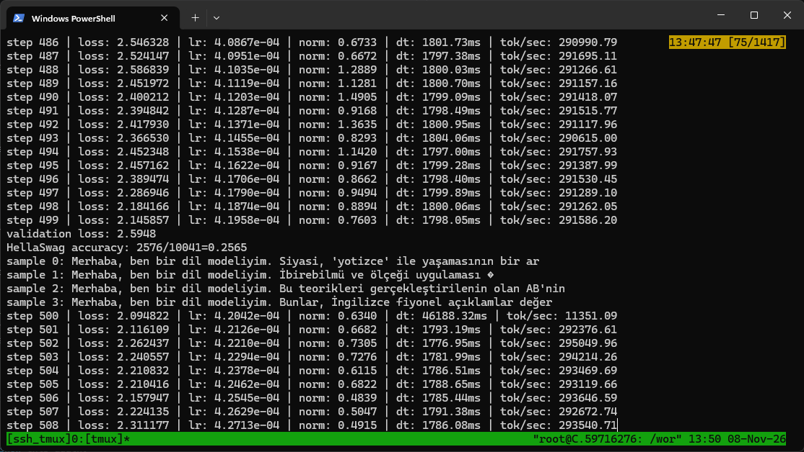

*Step 500 · val 2.5948 · HellaSwag-TR 0.2565 · mostly real words, wrong order*

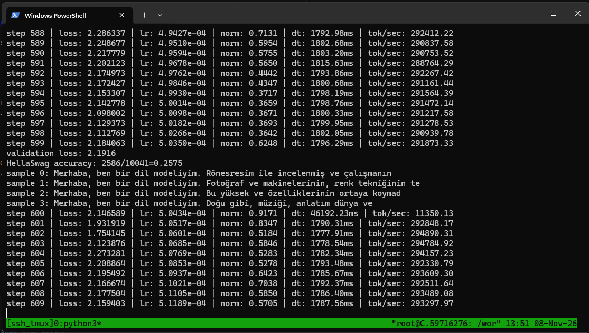

*Step 600 · val 2.1916 · HellaSwag-TR 0.2575 · `Fotoğraf ve makinelerinin, renk tekniğinin` ("Photography and its machines, of the color technique")*

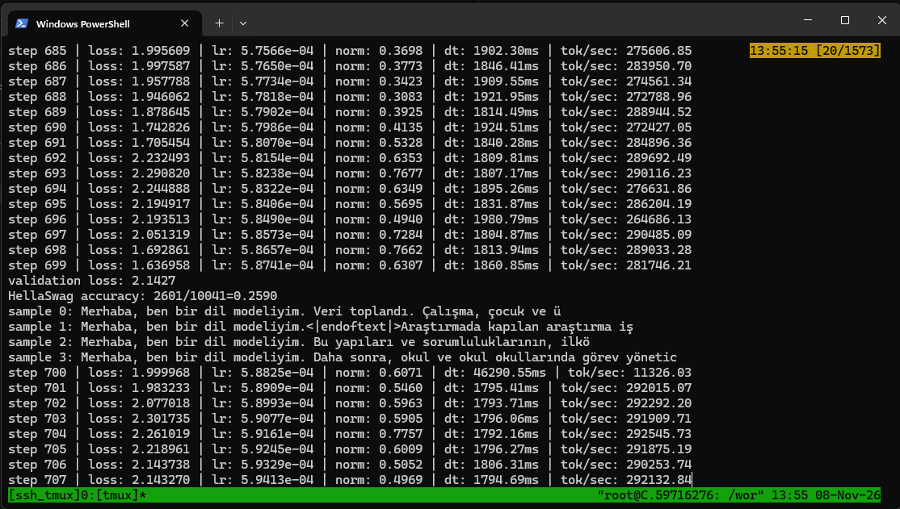

*Step 700 · val 2.1427 · HellaSwag-TR 0.2590 · first correct short sentence: `Veri toplandı.` ("The data was collected.")*

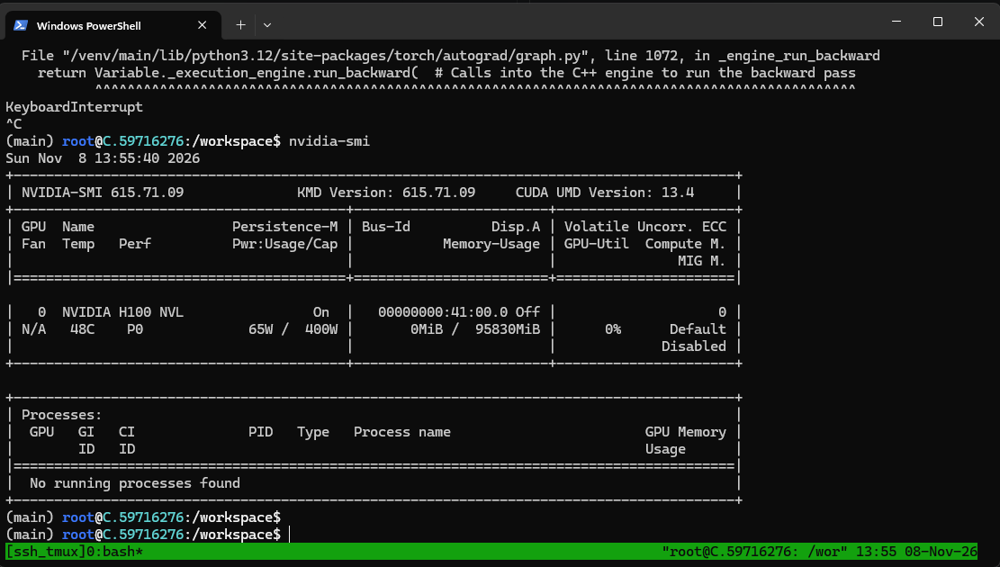

*Stopped with Ctrl+C after step 707. GPU: H100 NVL.*

### Results

| Step | Train loss | Val loss | HellaSwag-TR |
|---:|---:|---:|---:|
| 100 | 4.0795 | 4.3286 | 0.2465 |
| 200* | 3.5683 | 3.6075 | 0.2507 |
| 400 | 2.5841 | 2.8953 | 0.2499 |
| 500 | 2.0948 | 2.5948 | 0.2565 |
| 600 | 2.1466 | 2.1916 | 0.2575 |
| 700 | 2.0000 | **2.1427** | **0.2590** |

\* from run 2. Step 300 was not captured.

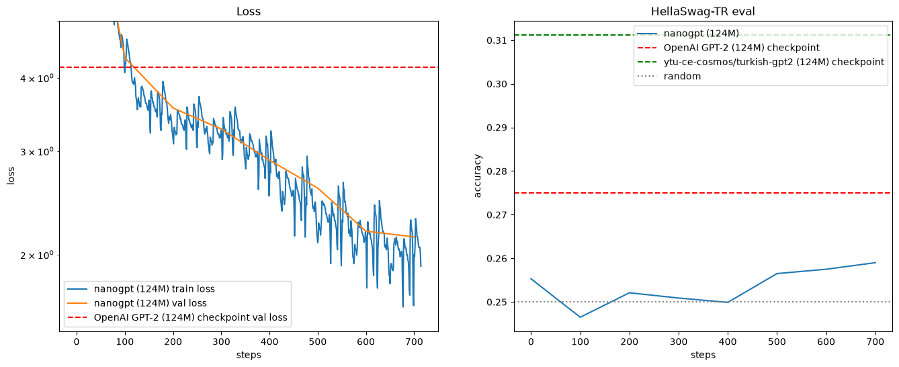

*Left: loss, GPT-2 on TR val in red (4.1691). The y axis stops at 5.0, so the first steps are cut off. Right: HellaSwag-TR with GPT-2 (red), turkish-gpt2 (green) and random (gray).*

### Notes

- **Val loss:** 4.33 → 2.14. Below GPT-2 before step 200. Same tokenizer, so a fair comparison.
- **HellaSwag-TR:** rises at every eval after step 400. 0.2590 is about 2 standard errors above chance. Still far from turkish-gpt2 (0.3112).
- **Train loss is noisy:** 1.64 to 2.30 within 20 steps. Nearby batches come from the same source, and some sources are easier.
- **Short samples:** GPT-2 splits Turkish into ≈ 2-character tokens, so 32 tokens give only about 5 words.
- **Eval cost:** ≈ 44 s per eval round.

## 3. English model

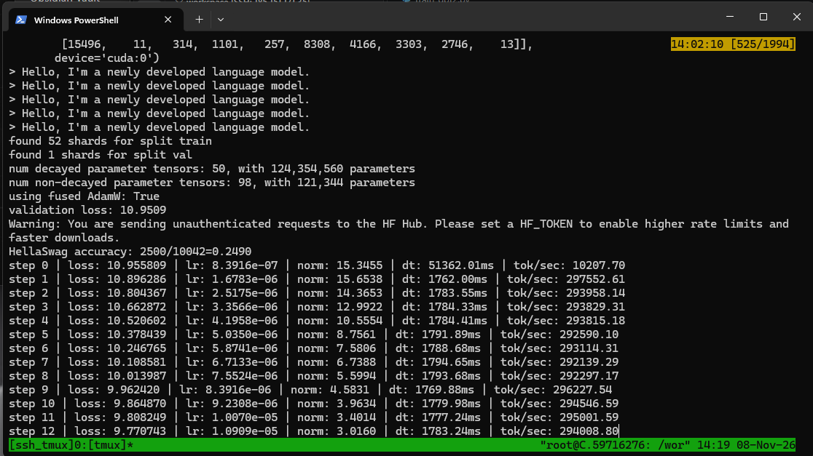

*Start · 52 train shards, 1 val shard · step 0: val 10.9509, HellaSwag 0.2490 (random)*

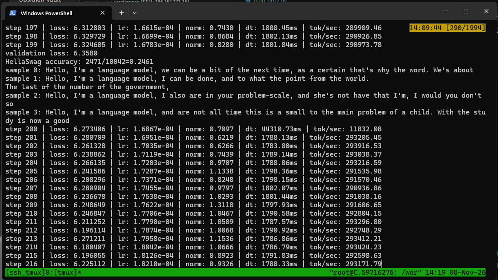

*Step 200 · val 6.3580 · HellaSwag 0.2461 · real English words: `I can be done, and to what the point from the world.`*

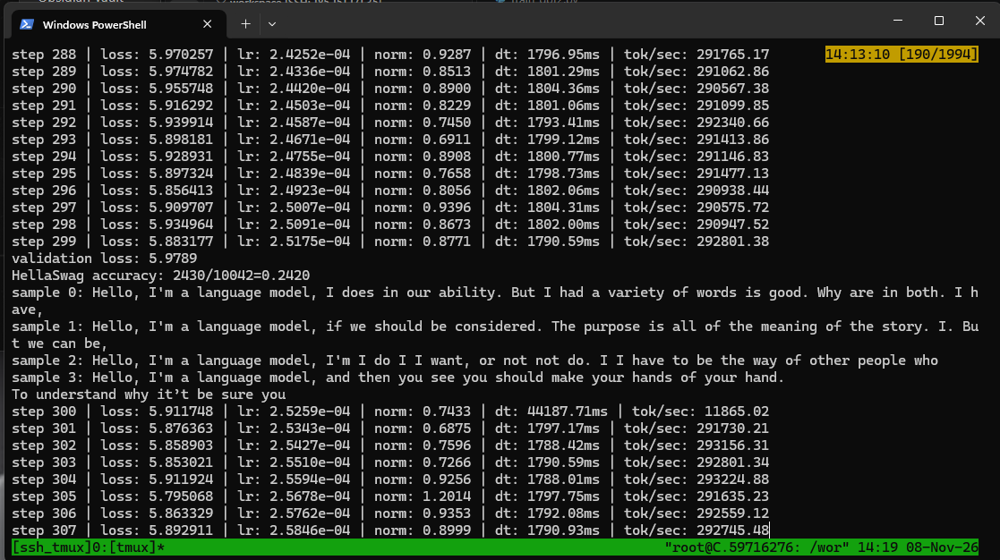

*Step 300 · val 5.9789 · HellaSwag 0.2420*

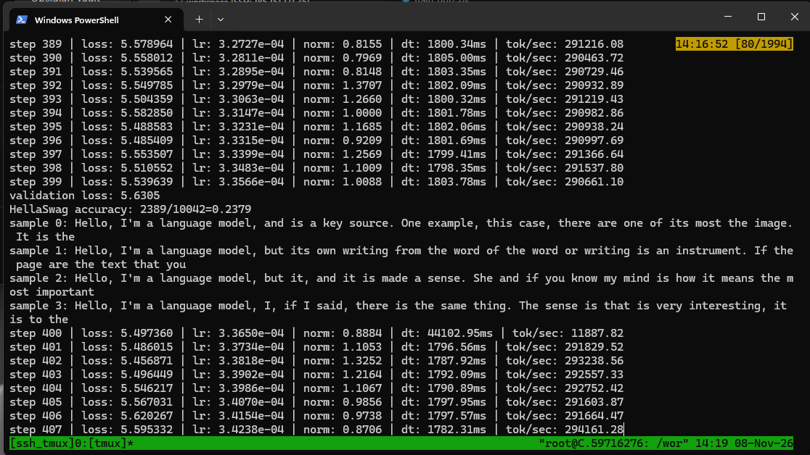

*Step 400 · val 5.6305 · HellaSwag 0.2379 (lowest)*

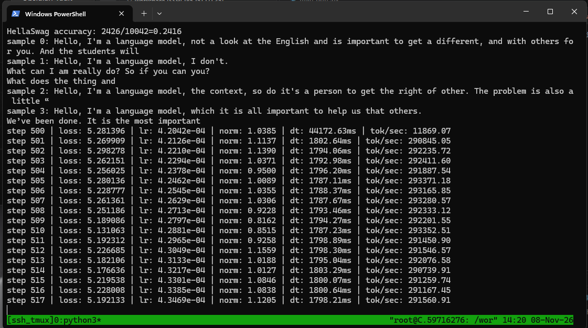

*Step 500 · val 5.3147 · HellaSwag 0.2416 · questions appear: `What can I am really do?`*

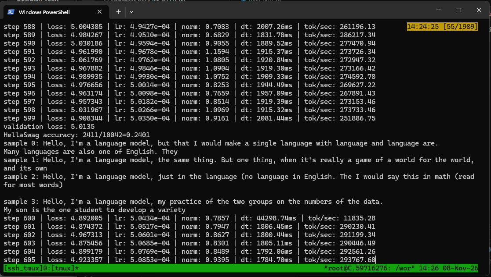

*Step 600 · val 5.0135 · HellaSwag 0.2401 · stays on topic: `Many languages are also one of English.`*

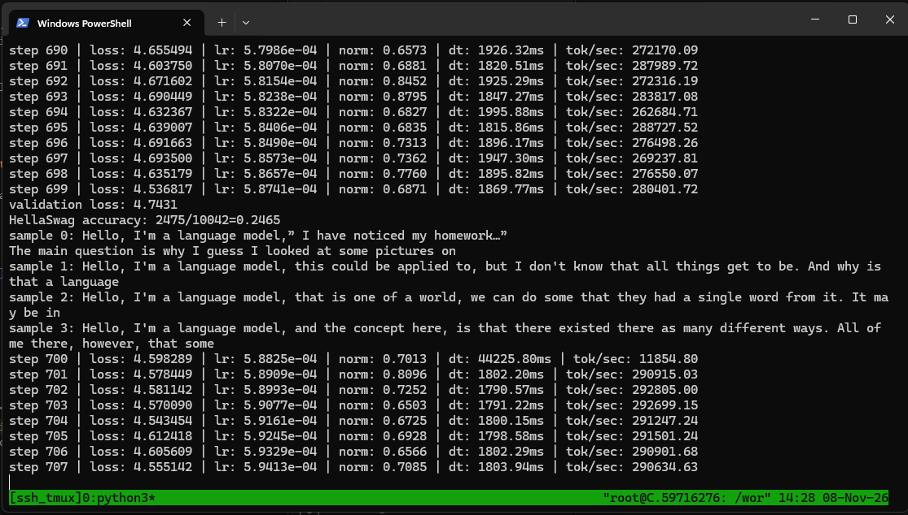

*Step 700 · val 4.7431 · HellaSwag 0.2465*

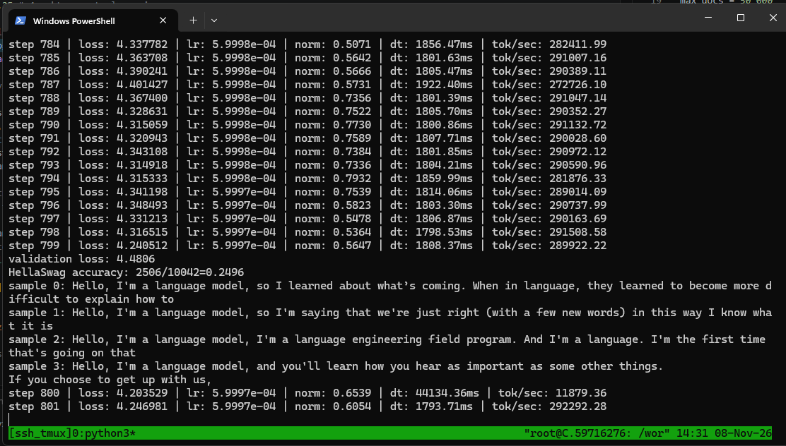

*Step 800 · val 4.4806 · HellaSwag 0.2496 · LR at its peak · most fluent: `so I'm saying that we're just right (with a few new words)`*

### Results

| Step | Train loss | Val loss | HellaSwag |
|---:|---:|---:|---:|
| 0 | 10.9558 | 10.9509 | 0.2490 |
| 100 | 7.0673 | 7.1746 | 0.2438 |
| 200 | 6.2734 | 6.3580 | 0.2461 |
| 300 | 5.9117 | 5.9789 | 0.2420 |
| 400 | 5.4974 | 5.6305 | 0.2379 |
| 500 | 5.2814 | 5.3147 | 0.2416 |
| 600 | 4.8920 | 5.0135 | 0.2401 |
| 700 | 4.5983 | 4.7431 | 0.2465 |
| 800 | 4.2035 | **4.4806** | **0.2496** |

Source: `log/log.txt`.

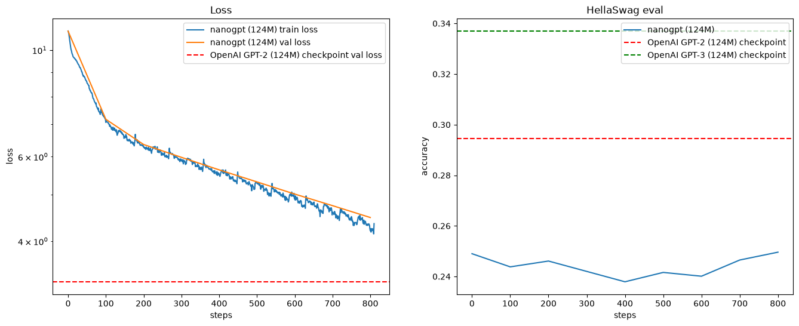

*Left: loss, GPT-2 in red (3.2924). Right: HellaSwag with GPT-2 (red, 0.2945) and GPT-3 (green, 0.337).*

### Notes

- **Val loss:** steady drop, 10.95 → 4.48. Small train/val gap. GPT-2's 3.29 needs about 10B tokens in build-nanogpt, and this run has seen 0.4B.
- **HellaSwag:** at or below chance. Wrong HellaSwag endings are chosen to fool language models, so an early model can do slightly worse than random.
- **Samples:** grammar comes before meaning. Real words at step 200, clauses and punctuation by step 800.

## 4. Turkish vs English

| Step | TR val | EN val | TR HellaSwag-TR | EN HellaSwag |
|---:|---:|---:|---:|---:|
| 100 | 4.3286 | 7.1746 | 0.2465 | 0.2438 |
| 400 | 2.8953 | 5.6305 | 0.2499 | 0.2379 |
| 600 | 2.1916 | 5.0135 | 0.2575 | 0.2401 |
| 700 | 2.1427 | 4.7431 | 0.2590 | 0.2465 |

- **Per-token losses can't be compared.** Turkish tokens are short (≈ 1.98 characters vs 4.36 in English), so they are easier to predict one by one. Per character the two are roughly equal: ≈ 1.08 (TR) vs ≈ 1.03 (EN) nats.
- **Against its own GPT-2 reference:** TR is far below (2.14 vs 4.17), EN is still above (4.48 vs 3.29).
- **HellaSwag:** both near chance. The datasets differ, so this is not a winner.
- **Speed:** same for both, ≈ 1.79 s/step, ≈ 291k tok/s.

## 5. Problems fixed

| Problem | Fix |
|---|---|
| Crash in sample generation | `.tolist()` before `enc.decode` |
| Original HellaSwag GitHub repo blocked (DMCA) | load from Hugging Face |
| hellaswag-tr label is a string (`"3"`), every answer counted wrong | `int(example["label"])` |
| English loss curve hidden in plot | removed `plt.ylim(top=4.0)` |

## 6. Next steps

- Train longer. Targets: turkish-gpt2 (0.3112) for TR, GPT-2 (3.2924 / 0.2945) for EN.
- Save checkpoints. The loop doesn't save the model yet.
- Use a separate log file per language. Both runs write to `log/log.txt`.
